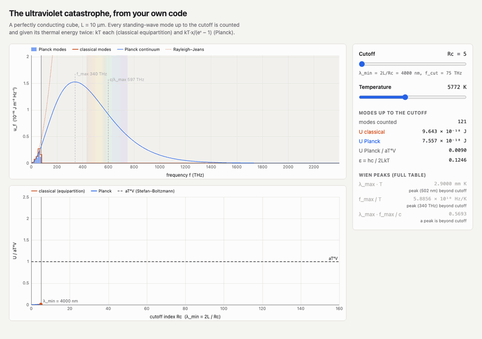

# uv-catastrophe

The ultraviolet catastrophe from your own code. The page counts every standing-wave mode of a perfectly conducting 10 µm cube, with the correct polarisation count per mode, up to |n| = 160. It then gives each mode its thermal energy two ways: kT for classical equipartition, and kT·x/(eˣ − 1) for Planck. Dragging the cutoff up makes the classical total grow as Rc³ and leave the panel, while the Planck total settles onto the Stefan–Boltzmann value aT⁴V. A quartic log-log fit to the binned spectrum recovers both Wien laws, and shows that the frequency peak and the wavelength peak are different photons. Every number on the page and in the GIF is computed live by the tested functions in `src/`.

**Live:** https://hammerheadllama.github.io/masterpiece/uv-catastrophe/
(`?T=9500&rc=160` style links set the sliders.)



## Verification gates

Generated by `npm run readme:gates` from the test run. The tolerance and prototype columns quote `SPEC.md`; the Measured column comes from the test log only.

<!-- gates:start -->
| Gate | Check | Tolerance | Spec prototype | Measured |
|---|---|---|---|---|
| 0 | build, tests, page | succeed; no console errors | n/a | build ok; 41/41 tests pass; console clean (browser check 2026-11-20) |
| 1 | mode table g[1..6]; Σg for m ≤ 160² | exact | 0, 3, 2, 0, 6, 6; 4,288,591 | 0, 3, 2, 0, 6, 6; 4,288,591 |
| 2 | Weyl: N/(πRc³/3) − 1 at Rc = 20, 160; log-log slope | < 1%, < 0.1%; 3 ± 0.01 | −0.69%, −0.017%; 3.003 | -0.6873%, -0.0170%; 3.00311 |
| 3 | Planck limits at x = 1e-8, 50, 800 | 1e-12 abs; 1e-12 rel; finite | n/a | 1.11e-16; 2.22e-16; 0 |
| 4 | U_P(160)/(aT⁴V) − 1; slope against T | < 1%; 4 ± 0.01 | worst −0.66% (3000 K); 4.005 | 3000 K -0.66%, 4000 K -0.38%, 5772 K -0.18%, 8000 K -0.13%, 9500 K -0.26%; slope 4.00371 |
| 5 | finite-size deficit vs −15ε²/(4π³) | within 10% relative | −0.00127, −0.00464, −0.01023 | ε=0.1: -0.001271 vs -0.001209; ε=0.2: -0.004644 vs -0.004838; ε=0.3: -0.010235 vs -0.010885 |
| 6 | ΔR = 2 bins vs continuum Planck, x ∈ [1, 10] | < 2% per bin | 0.8% (5772 K), 0.9% (9500 K) | 5772 K: worst -0.820% (36 bins); 9500 K: worst -0.919% (60 bins) |
| 7 | λ_max·T; f_max/T; λ_max·f_max/c over 5 temperatures | < 1%; < 2%; 0.568 ± 0.015 | +0.33%; +0.92%; n/a | worst -0.333% (4000 K); worst +0.916% (3000 K); 0.5666–0.5726 |
<!-- gates:end -->

## Run

```bash
npm install
npm run dev      # local page
npm test         # gates 1–7
npm run build    # writes ../../docs/uv-catastrophe for GitHub Pages
```

`python3 scripts/make_gif.py --base <page url> --out demo.gif` regenerates the GIF. It needs Google Chrome and Pillow.
